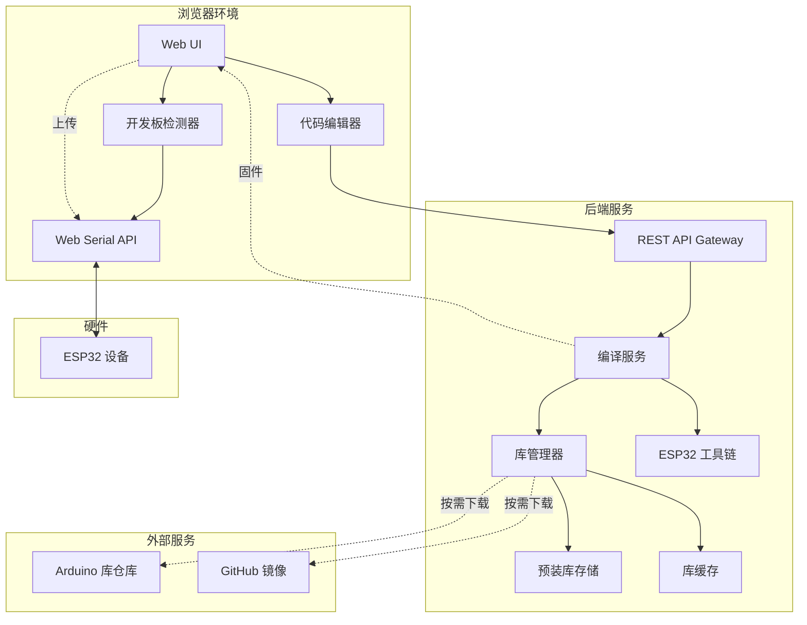
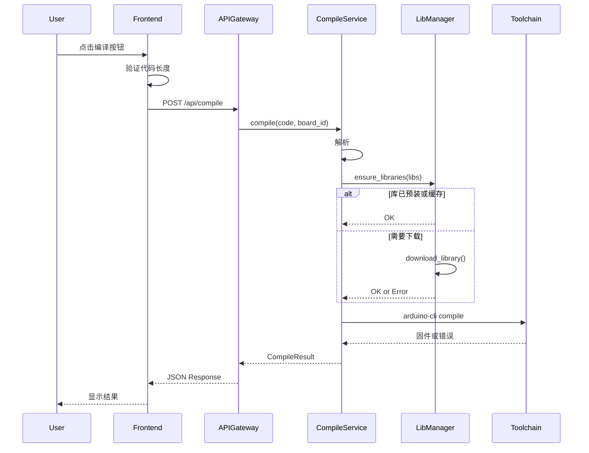
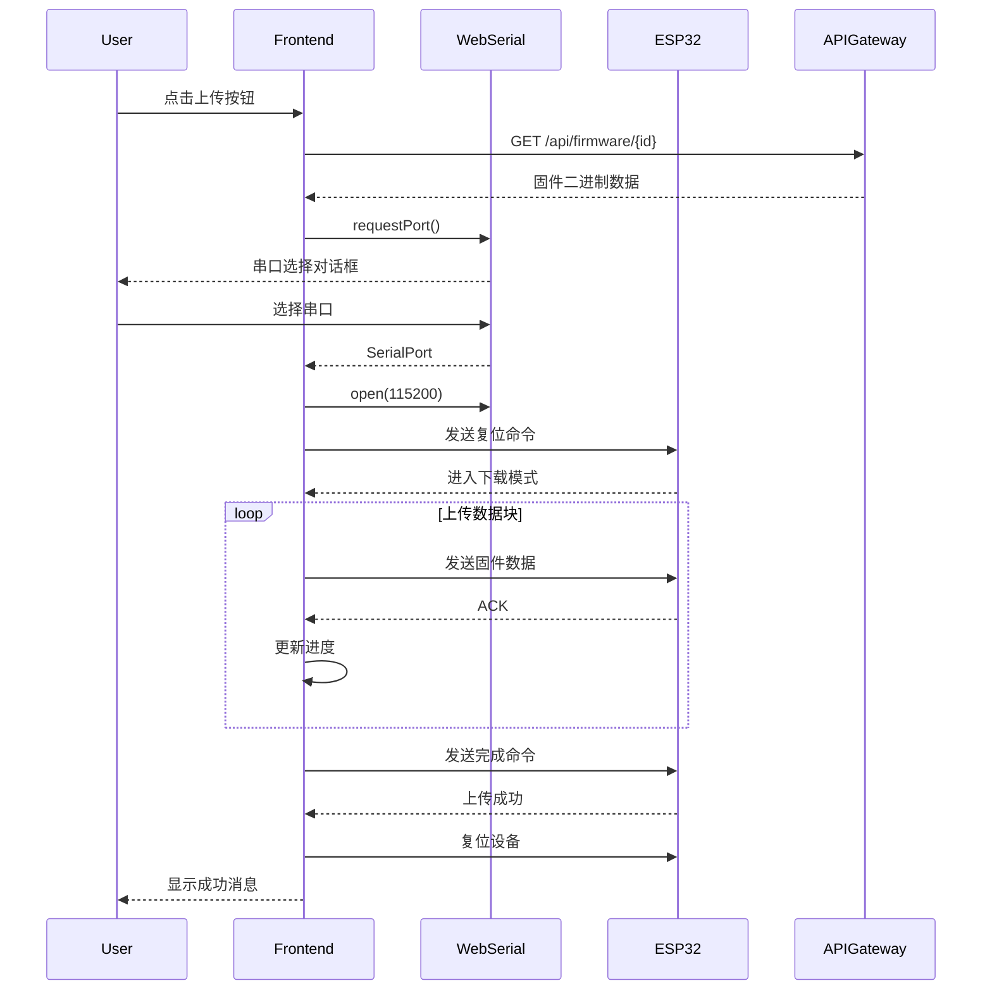
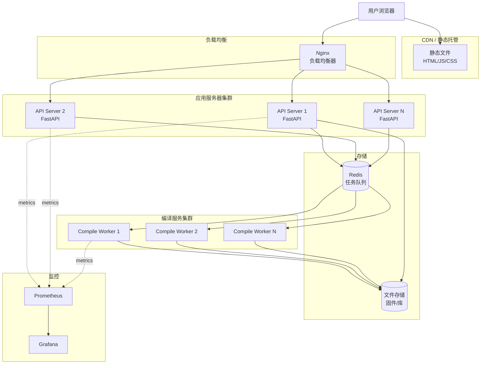

# 技术设计文档

## Overview

ESP 在线开发平台是一个基于 Web 的 ESP32 集成开发环境，采用前后端分离架构。前端通过现代浏览器的 Web Serial API 直接与 ESP32 设备通信，后端提供云端编译服务。系统的核心设计理念是"零配置"——用户无需安装任何软件、无需配置开发环境、无需注册账号，打开浏览器即可完成从代码编写到固件上传的完整开发流程。

### 设计目标

1. **零门槛**: 消除本地环境配置，降低 ESP32 开发入门难度
2. **高可用**: 服务器预装工具链和常用库，确保编译成功率
3. **快速响应**: 60 秒内完成编译，实时显示进度
4. **浏览器原生**: 利用 Web Serial API 实现设备通信，无需插件
5. **可扩展**: 支持按需下载库，覆盖长尾需求

### 技术约束

- 前端必须使用支持 Web Serial API 的浏览器（Chrome 89+, Edge 89+, Opera 75+）
- 后端编译服务需要 Linux 环境运行 ESP-IDF 工具链
- 单次编译时间限制 60 秒，超时返回错误
- 单次库下载时间限制 60 秒，超时返回错误
- 代码输入限制 50000 字符

## Technology Stack

### 前端技术栈

**核心框架**:
- **React 18** + **TypeScript**: 类型安全的组件开发
- **Vite**: 快速的开发服务器和构建工具
- **TailwindCSS**: 实用优先的 CSS 框架

**关键库**:
- **esptool-js**: Web Serial 版本的 ESP32 烧录工具
- **CodeMirror 6** (可选): 轻量级代码编辑器，支持语法高亮
- **zustand**: 轻量级状态管理
- **axios**: HTTP 客户端

**浏览器要求**:
- Chrome 89+ / Edge 89+ / Opera 75+
- 必须支持 Web Serial API

### 后端技术栈

**核心框架**:
- **Python 3.10+** + **FastAPI**: 高性能异步 Web 框架
- **Uvicorn**: ASGI 服务器
- **Pydantic**: 数据验证

**关键工具**:
- **Arduino CLI 0.35+**: ESP32 编译工具链
- **ESP32 Arduino Core**: ESP32 开发板支持包
- **Redis** (可选): 编译任务队列和结果缓存

**系统依赖**:
- **Linux (Ubuntu 22.04 推荐)**: 运行环境
- **Python 3.10+**: 运行时
- **Git**: 库下载
- **7zip**: 库解压

### 开发工具

**前端开发**:
- **ESLint** + **Prettier**: 代码规范
- **Jest** + **Testing Library**: 单元测试
- **Playwright**: E2E 测试

**后端开发**:
- **pytest**: 测试框架
- **black** + **isort**: 代码格式化
- **mypy**: 类型检查
- **ruff**: 快速 linter

**DevOps**:
- **Docker** + **Docker Compose**: 容器化
- **GitHub Actions**: CI/CD
- **Nginx**: 反向代理
- **Prometheus** + **Grafana**: 监控

## Architecture

### 系统架构图



### 架构层次

#### 1. 前端层（Browser Frontend）

- **职责**: 用户交互、代码编辑、设备通信
- **技术**: HTML5 + JavaScript + Web Serial API
- **组件**:
  - 代码输入组件：提供文本编辑功能
  - 开发板检测组件：通过 USB VID/PID 识别开发板
  - 串口上传组件：使用 Web Serial API 上传固件
  - 状态显示组件：显示编译和上传进度

#### 2. API 网关层（API Gateway）

- **职责**: 请求路由、参数验证、错误处理
- **技术**: Node.js + Express 或 Python + FastAPI
- **功能**:
  - 接收编译请求
  - 验证代码长度和格式
  - 返回编译结果或错误信息
  - 提供固件下载接口

#### 3. 编译服务层（Compilation Service）

- **职责**: 代码编译、依赖解析、固件生成
- **技术**: Arduino CLI + ESP32 工具链
- **流程**:
  1. 接收用户代码和开发板配置
  2. 创建临时项目目录
  3. 解析代码中的库依赖
  4. 调用库管理器确保依赖可用
  5. 执行编译命令
  6. 返回固件或错误信息
  7. 清理临时文件

#### 4. 库管理层（Library Management）

- **职责**: 库的预装、检测、下载、缓存
- **策略**:
  - **预装策略**: 服务器启动时安装 20-30 个常用库
  - **按需策略**: 检测到缺失库时通过代理下载
  - **缓存策略**: 下载的库永久缓存，避免重复下载
- **数据源**:
  - Arduino Library Manager
  - GitHub 仓库（通过国内镜像加速）

## Components and Interfaces

### 前端组件

#### 1. CodeEditor 组件

**职责**: 提供代码输入和基本编辑功能

**接口**:
```typescript
interface CodeEditor {
  // 获取当前代码内容
  getCode(): string;
  
  // 设置代码内容
  setCode(code: string): void;
  
  // 清空代码
  clear(): void;
  
  // 获取代码长度
  getLength(): number;
  
  // 监听代码变化
  onChange(callback: (code: string) => void): void;
}
```

**实现要点**:
- 使用 `<textarea>` 或轻量级编辑器（如 CodeMirror）
- 支持 50000 字符限制
- 提供字符计数显示
- 支持标准编辑操作（复制、粘贴、撤销、重做）

#### 2. BoardDetector 组件

**职责**: 检测连接的 ESP32 开发板型号

**接口**:
```typescript
interface BoardDetector {
  // 自动检测开发板
  detectBoard(): Promise<BoardInfo | null>;
  
  // 获取支持的开发板列表
  getSupportedBoards(): BoardInfo[];
  
  // 手动选择开发板
  selectBoard(boardId: string): void;
  
  // 获取当前选中的开发板
  getCurrentBoard(): BoardInfo | null;
}

interface BoardInfo {
  id: string;           // 开发板 ID，如 "esp32dev"
  name: string;         // 显示名称，如 "ESP32 Dev Module"
  vid: number;          // USB Vendor ID
  pid: number;          // USB Product ID
  compileFlags: string; // 编译参数
}
```

**检测逻辑**:
1. 调用 `navigator.serial.requestPort()` 获取串口
2. 读取 USB VID/PID
3. 匹配预定义的开发板数据库
4. 返回匹配的开发板信息或 null

**支持的开发板**（最少 5 种）:
- ESP32 Dev Module (通用)
- ESP32-WROOM-32
- ESP32-DevKitC
- NodeMCU-32S
- DOIT ESP32 DevKit v1

#### 3. FirmwareUploader 组件

**职责**: 通过 Web Serial API 上传固件到 ESP32

**接口**:
```typescript
interface FirmwareUploader {
  // 上传固件
  upload(firmware: ArrayBuffer, onProgress: (percent: number) => void): Promise<void>;
  
  // 取消上传
  cancel(): void;
  
  // 检查浏览器兼容性
  isSupported(): boolean;
}
```

**上传流程**:
1. 请求用户选择串口
2. 打开串口连接（波特率 115200）
3. 发送复位命令使 ESP32 进入下载模式
4. 使用 esptool.js 协议上传固件
5. 显示上传进度（0-100%）
6. 上传完成后复位设备

**依赖库**: esptool-js（Web Serial 版本的 esptool）

#### 4. CompilationClient 组件

**职责**: 与后端编译服务通信

**接口**:
```typescript
interface CompilationClient {
  // 提交编译请求
  compile(request: CompileRequest): Promise<CompileResult>;
  
  // 下载固件
  downloadFirmware(firmwareId: string): Promise<ArrayBuffer>;
}

interface CompileRequest {
  code: string;         // 用户代码
  boardId: string;      // 开发板 ID
}

interface CompileResult {
  success: boolean;
  firmwareId?: string;  // 固件 ID（成功时）
  firmwareSize?: number; // 固件大小（字节）
  errors?: CompileError[]; // 错误列表（失败时）
  warnings?: string[];  // 警告列表
  duration: number;     // 编译耗时（秒）
}

interface CompileError {
  type: string;         // 错误类型
  line: number;         // 错误行号
  message: string;      // 错误描述
}
```

### 后端组件

#### 1. CompilationService

**职责**: 核心编译逻辑

**接口**:
```python
class CompilationService:
    def compile(self, code: str, board_id: str) -> CompileResult:
        """
        编译用户代码
        
        Args:
            code: 用户代码
            board_id: 开发板 ID
            
        Returns:
            CompileResult: 编译结果
            
        Raises:
            TimeoutError: 编译超时（60秒）
            LibraryNotFoundError: 库下载失败
        """
        pass
    
    def get_firmware(self, firmware_id: str) -> bytes:
        """获取编译好的固件"""
        pass
```

**编译流程**:
```python
def compile(self, code: str, board_id: str) -> CompileResult:
    # 1. 创建临时项目目录
    project_dir = self._create_temp_project(code)
    
    # 2. 解析库依赖
    required_libs = self._parse_includes(code)
    
    # 3. 确保库可用
    self.library_manager.ensure_libraries(required_libs)
    
    # 4. 执行编译
    result = self._run_arduino_cli(project_dir, board_id, timeout=60)
    
    # 5. 处理结果
    if result.success:
        firmware_id = self._save_firmware(result.firmware_path)
        return CompileResult(success=True, firmware_id=firmware_id)
    else:
        errors = self._parse_errors(result.stderr)
        return CompileResult(success=False, errors=errors)
    
    # 6. 清理临时文件
    finally:
        self._cleanup(project_dir)
```

**依赖解析**:
```python
def _parse_includes(self, code: str) -> List[str]:
    """
    从代码中提取 #include 语句
    
    示例:
        #include <WiFi.h>        -> "WiFi"
        #include <PubSubClient.h> -> "PubSubClient"
        #include "myheader.h"    -> 忽略（本地文件）
    """
    import re
    pattern = r'#include\s*<([^>]+)\.h>'
    matches = re.findall(pattern, code)
    return list(set(matches))  # 去重
```

#### 2. LibraryManager

**职责**: 管理预装库和按需下载

**接口**:
```python
class LibraryManager:
    def __init__(self, preinstalled_libs: List[str], cache_dir: str):
        """
        初始化库管理器
        
        Args:
            preinstalled_libs: 预装库列表
            cache_dir: 库缓存目录
        """
        pass
    
    def ensure_libraries(self, lib_names: List[str]) -> None:
        """
        确保所有库可用，缺失的库会自动下载
        
        Args:
            lib_names: 需要的库名称列表
            
        Raises:
            LibraryNotFoundError: 库不存在或下载失败
            TimeoutError: 下载超时（60秒）
        """
        pass
    
    def is_preinstalled(self, lib_name: str) -> bool:
        """检查库是否预装"""
        pass
    
    def download_library(self, lib_name: str) -> None:
        """下载库到缓存目录"""
        pass
```

**预装库列表**（20-30 个）:

**核心库**:
- WiFi
- Bluetooth / BluetoothSerial
- SPIFFS
- SD
- Wire (I2C)
- SPI

**网络库**:
- HTTPClient
- WebServer
- PubSubClient (MQTT)
- ArduinoJson
- ESPAsyncWebServer
- AsyncTCP

**显示屏库**:
- Adafruit_GFX
- Adafruit_SSD1306
- TFT_eSPI
- U8g2

**传感器库**:
- DHT sensor library
- Adafruit_BME280
- OneWire
- DallasTemperature
- Adafruit_Sensor

**其他常用库**:
- FastLED
- Servo
- ESP32Servo
- Preferences
- ESPmDNS

**下载策略**:
```python
def download_library(self, lib_name: str) -> None:
    # 1. 检查缓存
    if self._is_cached(lib_name):
        return
    
    # 2. 尝试从 Arduino Library Manager 下载
    try:
        self._download_from_arduino(lib_name, timeout=60)
        return
    except Exception as e:
        logger.warning(f"Arduino download failed: {e}")
    
    # 3. 尝试从 GitHub 下载（使用国内镜像）
    try:
        self._download_from_github(lib_name, timeout=60)
        return
    except Exception as e:
        logger.error(f"GitHub download failed: {e}")
        raise LibraryNotFoundError(f"Cannot download library: {lib_name}")
```

#### 3. APIGateway

**职责**: HTTP API 接口

**端点**:

```
POST /api/compile
Content-Type: application/json

Request:
{
  "code": "void setup() { ... }",
  "board_id": "esp32dev"
}

Response (成功):
{
  "success": true,
  "firmware_id": "abc123",
  "firmware_size": 245760,
  "duration": 12.5,
  "warnings": []
}

Response (失败):
{
  "success": false,
  "errors": [
    {
      "type": "compile_error",
      "line": 15,
      "message": "'WiFi' was not declared in this scope"
    }
  ],
  "duration": 5.2
}
```

```
GET /api/firmware/{firmware_id}

Response:
Content-Type: application/octet-stream
Content-Disposition: attachment; filename="firmware.bin"

<binary firmware data>
```

```
GET /api/boards

Response:
{
  "boards": [
    {
      "id": "esp32dev",
      "name": "ESP32 Dev Module",
      "vid": 4292,
      "pid": 60000
    },
    ...
  ]
}
```

```
GET /api/health

Response:
{
  "status": "ok",
  "toolchain_version": "2.0.11",
  "preinstalled_libraries": 25
}
```

## Data Models

### 前端数据模型

#### EditorState

```typescript
interface EditorState {
  code: string;              // 当前代码
  selectedBoard: BoardInfo | null; // 选中的开发板
  isCompiling: boolean;      // 是否正在编译
  isUploading: boolean;      // 是否正在上传
  compileResult: CompileResult | null; // 最近的编译结果
  uploadProgress: number;    // 上传进度 (0-100)
}
```

#### BoardInfo

```typescript
interface BoardInfo {
  id: string;                // 开发板 ID
  name: string;              // 显示名称
  vid: number;               // USB Vendor ID
  pid: number;               // USB Product ID
  compileFlags: string;      // 编译参数
}
```

#### CompileResult

```typescript
interface CompileResult {
  success: boolean;
  firmwareId?: string;
  firmwareSize?: number;
  errors?: CompileError[];
  warnings?: string[];
  duration: number;
}

interface CompileError {
  type: string;
  line: number;
  message: string;
}
```

### 后端数据模型

#### CompileRequest

```python
from pydantic import BaseModel, Field

class CompileRequest(BaseModel):
    code: str = Field(..., max_length=50000, description="用户代码")
    board_id: str = Field(..., description="开发板 ID")
```

#### CompileResult

```python
from typing import List, Optional
from pydantic import BaseModel

class CompileError(BaseModel):
    type: str
    line: int
    message: str

class CompileResult(BaseModel):
    success: bool
    firmware_id: Optional[str] = None
    firmware_size: Optional[int] = None
    errors: Optional[List[CompileError]] = None
    warnings: Optional[List[str]] = None
    duration: float
```

#### LibraryInfo

```python
class LibraryInfo(BaseModel):
    name: str                  # 库名称
    version: str               # 版本号
    is_preinstalled: bool      # 是否预装
    install_path: str          # 安装路径
```

### 数据流

#### 编译流程数据流



#### 上传流程数据流



### 文件系统结构

#### 后端服务器文件结构

```
/opt/esp-online-platform/
├── arduino-cli              # Arduino CLI 可执行文件
├── esp32-toolchain/         # ESP32 工具链
├── libraries/               # 库目录
│   ├── preinstalled/        # 预装库
│   │   ├── WiFi/
│   │   ├── PubSubClient/
│   │   └── ...
│   └── cache/               # 按需下载的库缓存
│       ├── FastLED/
│       └── ...
├── temp/                    # 临时编译目录
│   └── {session_id}/        # 每个编译会话的临时目录
│       ├── sketch.ino
│       └── build/
└── firmware/                # 编译好的固件存储
    └── {firmware_id}.bin
```

#### 临时项目结构

```
temp/{session_id}/
├── sketch.ino               # 用户代码
└── build/                   # 编译输出
    ├── sketch.ino.bin       # 固件文件
    ├── sketch.ino.elf
    └── compile.log          # 编译日志
```


## Error Handling

### 错误分类

系统中的错误分为以下几类，每类有不同的处理策略：

#### 1. 用户输入错误（Client-Side Validation）

**错误类型**:
- 代码长度超过 50000 字符
- 代码为空
- 未选择开发板

**处理策略**:
- 在前端立即验证，不发送请求到后端
- 显示友好的错误提示
- 禁用编译按钮直到问题解决

**示例**:
```typescript
function validateCode(code: string): ValidationResult {
  if (code.length === 0) {
    return { valid: false, error: "代码不能为空" };
  }
  if (code.length > 50000) {
    return { valid: false, error: `代码长度超过限制（${code.length}/50000 字符）` };
  }
  return { valid: true };
}
```

#### 2. 浏览器兼容性错误

**错误类型**:
- 浏览器不支持 Web Serial API
- 用户拒绝串口权限

**处理策略**:
- 页面加载时检查 `navigator.serial` 是否存在
- 显示兼容性警告，列出支持的浏览器
- 提供浏览器下载链接

**示例**:
```typescript
function checkBrowserCompatibility(): CompatibilityResult {
  if (!('serial' in navigator)) {
    return {
      supported: false,
      message: "您的浏览器不支持 Web Serial API",
      supportedBrowsers: [
        { name: "Chrome", version: "89+", url: "https://www.google.com/chrome/" },
        { name: "Edge", version: "89+", url: "https://www.microsoft.com/edge" },
        { name: "Opera", version: "75+", url: "https://www.opera.com/" }
      ]
    };
  }
  return { supported: true };
}
```

#### 3. 编译错误（Compilation Errors）

**错误类型**:
- 语法错误
- 未声明的变量或函数
- 类型不匹配
- 缺少库文件

**处理策略**:
- 解析 arduino-cli 的错误输出
- 提取错误类型、行号、错误描述
- 在前端高亮显示错误行
- 提供可能的解决方案

**错误解析**:
```python
def parse_compile_errors(stderr: str) -> List[CompileError]:
    """
    解析编译错误输出
    
    示例输入:
    sketch.ino:15:3: error: 'WiFi' was not declared in this scope
    sketch.ino:20:5: error: expected ';' before 'delay'
    """
    errors = []
    pattern = r'sketch\.ino:(\d+):\d+:\s*(error|warning):\s*(.+)'
    
    for match in re.finditer(pattern, stderr):
        line_num = int(match.group(1))
        error_type = match.group(2)
        message = match.group(3)
        
        errors.append(CompileError(
            type=error_type,
            line=line_num,
            message=message
        ))
    
    return errors
```

**常见错误的友好提示**:
```python
ERROR_HINTS = {
    "'WiFi' was not declared": "缺少 WiFi 库，请检查是否包含 #include <WiFi.h>",
    "'PubSubClient' was not declared": "缺少 MQTT 库，请检查是否包含 #include <PubSubClient.h>",
    "expected ';'": "语法错误：缺少分号",
    "expected '}'": "语法错误：缺少右花括号",
}

def add_hint(error: CompileError) -> CompileError:
    for pattern, hint in ERROR_HINTS.items():
        if pattern in error.message:
            error.hint = hint
            break
    return error
```

#### 4. 库管理错误（Library Management Errors）

**错误类型**:
- 库不存在
- 库下载超时（60秒）
- 库下载失败（网络错误）
- 库版本不兼容

**处理策略**:
- 区分预装库和按需库
- 对于预装库缺失，记录错误日志并返回系统错误
- 对于按需库下载失败，返回明确的错误信息
- 提供手动解决方案（如库名拼写建议）

**示例**:
```python
class LibraryNotFoundError(Exception):
    def __init__(self, lib_name: str, suggestions: List[str] = None):
        self.lib_name = lib_name
        self.suggestions = suggestions or []
        message = f"库 '{lib_name}' 未找到"
        if suggestions:
            message += f"。您是否想要：{', '.join(suggestions)}"
        super().__init__(message)

def download_library(self, lib_name: str) -> None:
    try:
        self._download_with_timeout(lib_name, timeout=60)
    except TimeoutError:
        raise LibraryDownloadError(
            f"库 '{lib_name}' 下载超时（60秒）。请稍后重试。"
        )
    except NetworkError as e:
        raise LibraryDownloadError(
            f"库 '{lib_name}' 下载失败：{e}。请检查网络连接。"
        )
```

#### 5. 编译超时错误

**错误类型**:
- 编译时间超过 60 秒

**处理策略**:
- 使用 `subprocess.run(timeout=60)` 限制编译时间
- 超时后终止编译进程
- 返回超时错误信息
- 建议用户简化代码或联系支持

**示例**:
```python
def _run_arduino_cli(self, project_dir: str, board_id: str, timeout: int = 60) -> CompileResult:
    try:
        result = subprocess.run(
            ['arduino-cli', 'compile', '--fqbn', f'esp32:esp32:{board_id}', project_dir],
            capture_output=True,
            text=True,
            timeout=timeout
        )
        return self._process_result(result)
    except subprocess.TimeoutExpired:
        raise CompilationTimeoutError(
            f"编译超时（{timeout}秒）。请尝试简化代码或联系技术支持。"
        )
```

#### 6. 固件上传错误（Upload Errors）

**错误类型**:
- 串口连接失败
- 设备未进入下载模式
- 上传数据传输错误
- 设备断开连接

**处理策略**:
- 捕获 Web Serial API 异常
- 提供详细的错误信息和解决步骤
- 允许用户重试上传

**示例**:
```typescript
async function uploadFirmware(firmware: ArrayBuffer): Promise<void> {
  let port: SerialPort | null = null;
  
  try {
    // 请求串口
    port = await navigator.serial.requestPort();
    await port.open({ baudRate: 115200 });
    
    // 发送复位命令
    await resetDevice(port);
    
    // 上传固件
    await uploadData(port, firmware);
    
  } catch (error) {
    if (error instanceof DOMException) {
      if (error.name === 'NotFoundError') {
        throw new UploadError('未找到串口设备。请确保 ESP32 已连接。');
      } else if (error.name === 'SecurityError') {
        throw new UploadError('串口访问被拒绝。请授予串口权限。');
      }
    } else if (error instanceof NetworkError) {
      throw new UploadError('设备通信失败。请检查连接并重试。');
    }
    throw new UploadError(`上传失败：${error.message}`);
    
  } finally {
    // 确保关闭串口
    if (port) {
      try {
        await port.close();
      } catch (e) {
        console.error('关闭串口失败:', e);
      }
    }
  }
}
```

#### 7. 系统错误（System Errors）

**错误类型**:
- 服务器内部错误
- 磁盘空间不足
- 工具链损坏
- 临时文件清理失败

**处理策略**:
- 记录详细的错误日志
- 返回通用的错误信息给用户
- 不暴露系统内部细节
- 触发告警通知管理员

**示例**:
```python
@app.exception_handler(Exception)
async def global_exception_handler(request: Request, exc: Exception):
    # 记录详细错误
    logger.error(f"Unhandled exception: {exc}", exc_info=True)
    
    # 返回通用错误
    return JSONResponse(
        status_code=500,
        content={
            "success": false,
            "error": "服务器内部错误，请稍后重试。如果问题持续，请联系技术支持。",
            "error_id": str(uuid.uuid4())  # 用于追踪
        }
    )
```

### 错误响应格式

所有 API 错误响应遵循统一格式：

```json
{
  "success": false,
  "error_type": "compilation_error | library_error | timeout_error | system_error",
  "message": "用户友好的错误描述",
  "details": {
    "errors": [
      {
        "line": 15,
        "type": "error",
        "message": "'WiFi' was not declared in this scope",
        "hint": "缺少 WiFi 库，请检查是否包含 #include <WiFi.h>"
      }
    ]
  },
  "error_id": "uuid-for-tracking"
}
```

### 错误恢复策略

#### 自动重试

对于临时性错误，实现自动重试机制：

```python
from tenacity import retry, stop_after_attempt, wait_exponential

@retry(
    stop=stop_after_attempt(3),
    wait=wait_exponential(multiplier=1, min=2, max=10)
)
def download_library_with_retry(self, lib_name: str) -> None:
    """下载库，失败时自动重试最多 3 次"""
    self._download_library(lib_name)
```

#### 降级策略

当某些功能不可用时，提供降级方案：

```python
def ensure_libraries(self, lib_names: List[str]) -> None:
    """
    确保库可用，部分失败时继续编译
    """
    missing_libs = []
    
    for lib_name in lib_names:
        if self.is_preinstalled(lib_name):
            continue
        
        try:
            self.download_library(lib_name)
        except LibraryDownloadError as e:
            logger.warning(f"Failed to download {lib_name}: {e}")
            missing_libs.append(lib_name)
    
    if missing_libs:
        # 尝试编译，可能某些库是可选的
        logger.info(f"Proceeding with missing libraries: {missing_libs}")
```

#### 清理和资源释放

确保错误发生时正确清理资源：

```python
def compile(self, code: str, board_id: str) -> CompileResult:
    project_dir = None
    try:
        project_dir = self._create_temp_project(code)
        # ... 编译逻辑 ...
    except Exception as e:
        logger.error(f"Compilation failed: {e}")
        raise
    finally:
        # 无论成功失败都清理临时文件
        if project_dir and os.path.exists(project_dir):
            try:
                shutil.rmtree(project_dir)
            except Exception as e:
                logger.error(f"Failed to cleanup {project_dir}: {e}")
```

## Testing Strategy

由于本项目主要涉及 **UI 交互、硬件通信、外部服务集成**，不适合使用 Property-Based Testing。测试策略将采用以下方法：

### 1. 单元测试（Unit Tests）

测试纯函数逻辑和独立组件，使用 mock 隔离外部依赖。

#### 前端单元测试

**测试框架**: Jest + Testing Library

**测试范围**:
- 代码验证逻辑
- 错误解析函数
- 开发板信息匹配
- 状态管理逻辑

**示例测试**:
```typescript
describe('CodeEditor Validation', () => {
  test('应拒绝空代码', () => {
    const result = validateCode('');
    expect(result.valid).toBe(false);
    expect(result.error).toContain('不能为空');
  });
  
  test('应拒绝超长代码', () => {
    const longCode = 'a'.repeat(50001);
    const result = validateCode(longCode);
    expect(result.valid).toBe(false);
    expect(result.error).toContain('超过限制');
  });
  
  test('应接受有效代码', () => {
    const code = 'void setup() { }';
    const result = validateCode(code);
    expect(result.valid).toBe(true);
  });
});

describe('BoardDetector', () => {
  test('应根据 VID/PID 识别开发板', () => {
    const board = matchBoard(4292, 60000);
    expect(board?.id).toBe('esp32dev');
    expect(board?.name).toBe('ESP32 Dev Module');
  });
  
  test('未知设备应返回 null', () => {
    const board = matchBoard(9999, 9999);
    expect(board).toBeNull();
  });
});
```

#### 后端单元测试

**测试框架**: pytest

**测试范围**:
- Include 语句解析
- 编译错误解析
- 库名验证
- 错误提示生成

**示例测试**:
```python
def test_parse_includes():
    code = '''
    #include <WiFi.h>
    #include <PubSubClient.h>
    #include "local.h"
    '''
    libs = parse_includes(code)
    assert libs == ['WiFi', 'PubSubClient']
    assert 'local' not in libs  # 本地文件应被忽略

def test_parse_compile_errors():
    stderr = "sketch.ino:15:3: error: 'WiFi' was not declared in this scope"
    errors = parse_compile_errors(stderr)
    assert len(errors) == 1
    assert errors[0].line == 15
    assert errors[0].type == 'error'
    assert 'WiFi' in errors[0].message

def test_library_name_validation():
    assert is_valid_library_name('WiFi') == True
    assert is_valid_library_name('PubSubClient') == True
    assert is_valid_library_name('../../../etc/passwd') == False
    assert is_valid_library_name('lib; rm -rf /') == False
```

### 2. 集成测试（Integration Tests）

测试组件之间的交互和 API 端点。

#### API 集成测试

**测试框架**: pytest + httpx

**测试范围**:
- API 端点响应
- 请求验证
- 错误处理
- 编译流程（使用真实工具链）

**示例测试**:
```python
@pytest.mark.integration
async def test_compile_simple_sketch(client: AsyncClient):
    code = '''
    void setup() {
      Serial.begin(115200);
    }
    void loop() {
      delay(1000);
    }
    '''
    response = await client.post('/api/compile', json={
        'code': code,
        'board_id': 'esp32dev'
    })
    assert response.status_code == 200
    data = response.json()
    assert data['success'] == True
    assert 'firmware_id' in data
    assert data['duration'] < 60

@pytest.mark.integration
async def test_compile_with_wifi(client: AsyncClient):
    code = '''
    #include <WiFi.h>
    void setup() {
      WiFi.begin("ssid", "password");
    }
    void loop() {}
    '''
    response = await client.post('/api/compile', json={
        'code': code,
        'board_id': 'esp32dev'
    })
    assert response.status_code == 200
    assert response.json()['success'] == True

@pytest.mark.integration
async def test_compile_with_missing_library(client: AsyncClient):
    code = '''
    #include <NonExistentLibrary.h>
    void setup() {}
    void loop() {}
    '''
    response = await client.post('/api/compile', json={
        'code': code,
        'board_id': 'esp32dev'
    })
    assert response.status_code == 200
    data = response.json()
    assert data['success'] == False
    assert any('NonExistentLibrary' in err['message'] for err in data['errors'])
```

#### 库管理集成测试

**测试范围**:
- 预装库检测
- 库下载流程
- 缓存机制
- 超时处理

**示例测试**:
```python
@pytest.mark.integration
def test_preinstalled_library_available(lib_manager: LibraryManager):
    assert lib_manager.is_preinstalled('WiFi') == True
    assert lib_manager.is_preinstalled('PubSubClient') == True

@pytest.mark.integration
def test_download_library(lib_manager: LibraryManager):
    # 清除缓存
    lib_manager.clear_cache('FastLED')
    
    # 下载库
    lib_manager.download_library('FastLED')
    
    # 验证库已缓存
    assert lib_manager.is_cached('FastLED') == True

@pytest.mark.integration
def test_library_download_timeout(lib_manager: LibraryManager):
    with pytest.raises(TimeoutError):
        lib_manager.download_library('NonExistent', timeout=5)
```

### 3. 端到端测试（E2E Tests）

测试完整的用户流程，从 UI 到后端。

**测试框架**: Playwright 或 Cypress

**测试范围**:
- 完整编译流程
- 开发板选择
- 错误显示
- 浏览器兼容性检查

**示例测试**:
```typescript
test('完整编译流程', async ({ page }) => {
  await page.goto('http://localhost:3000');
  
  // 输入代码
  await page.fill('#code-editor', `
    void setup() {
      Serial.begin(115200);
    }
    void loop() {
      Serial.println("Hello");
      delay(1000);
    }
  `);
  
  // 选择开发板
  await page.selectOption('#board-select', 'esp32dev');
  
  // 点击编译
  await page.click('#compile-button');
  
  // 等待编译完成
  await page.waitForSelector('.compile-success', { timeout: 60000 });
  
  // 验证结果
  const successMessage = await page.textContent('.compile-success');
  expect(successMessage).toContain('编译成功');
  
  // 验证上传按钮可用
  const uploadButton = await page.$('#upload-button');
  expect(await uploadButton.isEnabled()).toBe(true);
});

test('显示编译错误', async ({ page }) => {
  await page.goto('http://localhost:3000');
  
  // 输入错误代码
  await page.fill('#code-editor', `
    void setup() {
      undeclaredFunction();  // 错误：未声明的函数
    }
    void loop() {}
  `);
  
  await page.selectOption('#board-select', 'esp32dev');
  await page.click('#compile-button');
  
  // 等待错误显示
  await page.waitForSelector('.compile-error');
  
  // 验证错误信息
  const errorMessage = await page.textContent('.compile-error');
  expect(errorMessage).toContain('undeclaredFunction');
  expect(errorMessage).toContain('was not declared');
});
```

### 4. Mock 测试

使用 mock 隔离外部依赖，测试错误处理和边界情况。

#### Mock Web Serial API

```typescript
// 测试串口权限被拒绝
test('处理串口权限拒绝', async () => {
  const mockSerial = {
    requestPort: jest.fn().mockRejectedValue(
      new DOMException('Permission denied', 'SecurityError')
    )
  };
  
  (navigator as any).serial = mockSerial;
  
  const uploader = new FirmwareUploader();
  await expect(uploader.upload(new ArrayBuffer(0), () => {}))
    .rejects.toThrow('串口访问被拒绝');
});
```

#### Mock 编译服务

```python
@pytest.fixture
def mock_arduino_cli(monkeypatch):
    def mock_run(*args, **kwargs):
        return subprocess.CompletedProcess(
            args=args,
            returncode=0,
            stdout='Compilation complete',
            stderr=''
        )
    monkeypatch.setattr(subprocess, 'run', mock_run)

def test_compile_success(mock_arduino_cli, compile_service):
    result = compile_service.compile('void setup() {}', 'esp32dev')
    assert result.success == True
```

### 5. 性能测试

验证系统在负载下的表现。

**测试工具**: Locust 或 k6

**测试场景**:
- 并发编译请求
- 编译时间测量
- 库下载性能
- 内存使用监控

**示例测试**:
```python
from locust import HttpUser, task, between

class CompileUser(HttpUser):
    wait_time = between(1, 3)
    
    @task
    def compile_simple_sketch(self):
        self.client.post('/api/compile', json={
            'code': 'void setup() {} void loop() {}',
            'board_id': 'esp32dev'
        })
    
    @task
    def compile_with_wifi(self):
        self.client.post('/api/compile', json={
            'code': '#include <WiFi.h>\nvoid setup() {} void loop() {}',
            'board_id': 'esp32dev'
        })
```

### 6. 安全测试

验证系统对恶意输入的防护。

**测试范围**:
- 代码注入防护
- 路径遍历防护
- 命令注入防护
- 资源限制

**示例测试**:
```python
def test_prevent_path_traversal():
    """防止路径遍历攻击"""
    malicious_code = '#include <../../../etc/passwd>'
    response = client.post('/api/compile', json={
        'code': malicious_code,
        'board_id': 'esp32dev'
    })
    # 应该安全失败，不暴露系统文件
    assert response.status_code in [400, 500]

def test_prevent_command_injection():
    """防止命令注入"""
    malicious_board = 'esp32dev; rm -rf /'
    response = client.post('/api/compile', json={
        'code': 'void setup() {}',
        'board_id': malicious_board
    })
    assert response.status_code == 400

def test_code_size_limit():
    """验证代码大小限制"""
    huge_code = 'a' * 100000
    response = client.post('/api/compile', json={
        'code': huge_code,
        'board_id': 'esp32dev'
    })
    assert response.status_code == 400
```

### 测试覆盖率目标

- **单元测试覆盖率**: ≥ 80%
- **集成测试覆盖率**: 所有 API 端点
- **E2E 测试覆盖率**: 所有核心用户流程
- **关键路径覆盖**: 100%（编译、上传、错误处理）

### 测试环境

#### 开发环境
- 本地运行所有测试
- 使用 mock 加速测试
- 快速反馈循环

#### CI/CD 环境
- 每次提交运行单元测试
- 每次 PR 运行集成测试
- 每日运行 E2E 测试
- 每周运行性能测试

#### 测试数据
- 使用真实的 ESP32 示例代码
- 包含常见错误场景
- 覆盖所有支持的库
- 测试边界条件（空代码、超长代码、特殊字符）

### 测试自动化

```yaml
# .github/workflows/test.yml
name: Test Suite

on: [push, pull_request]

jobs:
  unit-tests:
    runs-on: ubuntu-latest
    steps:
      - uses: actions/checkout@v2
      - name: Run unit tests
        run: |
          npm test
          pytest tests/unit/
  
  integration-tests:
    runs-on: ubuntu-latest
    steps:
      - uses: actions/checkout@v2
      - name: Setup ESP32 toolchain
        run: ./scripts/setup-toolchain.sh
      - name: Run integration tests
        run: pytest tests/integration/
  
  e2e-tests:
    runs-on: ubuntu-latest
    steps:
      - uses: actions/checkout@v2
      - name: Start services
        run: docker-compose up -d
      - name: Run E2E tests
        run: npx playwright test
```


## Deployment

### 部署架构



### 部署方案

#### 方案 1: 单机部署（开发/测试环境）

**适用场景**: 开发测试、小规模使用（<100 用户）

**架构**:
```
单台服务器
├── Nginx (前端静态文件 + 反向代理)
├── FastAPI (API 服务)
├── Arduino CLI (编译工具)
└── 本地文件系统 (库和固件存储)
```

**配置要求**:
- **CPU**: 4 核
- **内存**: 8GB
- **磁盘**: 50GB SSD
- **带宽**: 10Mbps

**Docker Compose 配置**:
```yaml
version: '3.8'

services:
  frontend:
    image: nginx:alpine
    ports:
      - "80:80"
      - "443:443"
    volumes:
      - ./frontend/dist:/usr/share/nginx/html
      - ./nginx.conf:/etc/nginx/nginx.conf
    depends_on:
      - backend

  backend:
    build: ./backend
    environment:
      - ARDUINO_CLI_PATH=/usr/local/bin/arduino-cli
      - LIBRARY_PATH=/opt/libraries
      - TEMP_PATH=/tmp/compile
      - FIRMWARE_PATH=/opt/firmware
    volumes:
      - libraries:/opt/libraries
      - firmware:/opt/firmware
      - /tmp/compile:/tmp/compile
    ports:
      - "8000:8000"

volumes:
  libraries:
  firmware:
```

**部署步骤**:
```bash
# 1. 克隆代码
git clone https://github.com/your-org/esp-online-platform.git
cd esp-online-platform

# 2. 构建前端
cd frontend
npm install
npm run build

# 3. 启动服务
cd ..
docker-compose up -d

# 4. 初始化工具链和预装库
docker-compose exec backend python scripts/init_toolchain.py
docker-compose exec backend python scripts/install_preinstalled_libs.py

# 5. 验证服务
curl http://localhost/api/health
```

#### 方案 2: 生产部署（推荐）

**适用场景**: 生产环境、高并发（>1000 用户）

**架构**:
- **前端**: CDN 托管静态文件（阿里云 OSS + CDN）
- **API 层**: 多实例 FastAPI（2-4 实例）
- **编译层**: 独立编译服务集群（4-8 worker）
- **任务队列**: Redis（持久化）
- **存储**: 对象存储（阿里云 OSS）
- **负载均衡**: Nginx 或云负载均衡器

**配置要求**:

*API 服务器*:
- **CPU**: 2 核 × N 实例
- **内存**: 4GB × N 实例
- **实例数**: 2-4

*编译服务器*:
- **CPU**: 4 核 × N 实例
- **内存**: 8GB × N 实例
- **磁盘**: 100GB SSD × N 实例
- **实例数**: 4-8

*Redis*:
- **内存**: 4GB
- **持久化**: AOF + RDB

**Kubernetes 部署配置**:

```yaml
# api-deployment.yaml
apiVersion: apps/v1
kind: Deployment
metadata:
  name: esp-api
spec:
  replicas: 3
  selector:
    matchLabels:
      app: esp-api
  template:
    metadata:
      labels:
        app: esp-api
    spec:
      containers:
      - name: api
        image: your-registry/esp-api:latest
        ports:
        - containerPort: 8000
        env:
        - name: REDIS_URL
          value: "redis://redis:6379"
        - name: OSS_ENDPOINT
          valueFrom:
            secretKeyRef:
              name: oss-credentials
              key: endpoint
        resources:
          requests:
            memory: "2Gi"
            cpu: "1"
          limits:
            memory: "4Gi"
            cpu: "2"
        livenessProbe:
          httpGet:
            path: /api/health
            port: 8000
          initialDelaySeconds: 30
          periodSeconds: 10
        readinessProbe:
          httpGet:
            path: /api/health
            port: 8000
          initialDelaySeconds: 5
          periodSeconds: 5
---
# compile-worker-deployment.yaml
apiVersion: apps/v1
kind: Deployment
metadata:
  name: esp-compile-worker
spec:
  replicas: 4
  selector:
    matchLabels:
      app: esp-compile-worker
  template:
    metadata:
      labels:
        app: esp-compile-worker
    spec:
      containers:
      - name: worker
        image: your-registry/esp-compile-worker:latest
        env:
        - name: REDIS_URL
          value: "redis://redis:6379"
        - name: WORKER_CONCURRENCY
          value: "2"
        resources:
          requests:
            memory: "4Gi"
            cpu: "2"
          limits:
            memory: "8Gi"
            cpu: "4"
        volumeMounts:
        - name: libraries
          mountPath: /opt/libraries
        - name: temp
          mountPath: /tmp/compile
      volumes:
      - name: libraries
        persistentVolumeClaim:
          claimName: libraries-pvc
      - name: temp
        emptyDir: {}
---
# redis-deployment.yaml
apiVersion: apps/v1
kind: Deployment
metadata:
  name: redis
spec:
  replicas: 1
  selector:
    matchLabels:
      app: redis
  template:
    metadata:
      labels:
        app: redis
    spec:
      containers:
      - name: redis
        image: redis:7-alpine
        ports:
        - containerPort: 6379
        volumeMounts:
        - name: redis-data
          mountPath: /data
        command:
        - redis-server
        - --appendonly yes
        - --maxmemory 2gb
        - --maxmemory-policy allkeys-lru
      volumes:
      - name: redis-data
        persistentVolumeClaim:
          claimName: redis-pvc
---
# service.yaml
apiVersion: v1
kind: Service
metadata:
  name: esp-api
spec:
  selector:
    app: esp-api
  ports:
  - port: 80
    targetPort: 8000
  type: LoadBalancer
---
apiVersion: v1
kind: Service
metadata:
  name: redis
spec:
  selector:
    app: redis
  ports:
  - port: 6379
    targetPort: 6379
  type: ClusterIP
```

**部署步骤**:
```bash
# 1. 构建镜像
docker build -t your-registry/esp-api:latest ./backend
docker build -t your-registry/esp-compile-worker:latest ./backend -f Dockerfile.worker
docker push your-registry/esp-api:latest
docker push your-registry/esp-compile-worker:latest

# 2. 创建命名空间
kubectl create namespace esp-platform

# 3. 创建 secrets
kubectl create secret generic oss-credentials \
  --from-literal=endpoint=https://oss-cn-hangzhou.aliyuncs.com \
  --from-literal=access-key=YOUR_ACCESS_KEY \
  --from-literal=secret-key=YOUR_SECRET_KEY \
  -n esp-platform

# 4. 部署服务
kubectl apply -f k8s/ -n esp-platform

# 5. 初始化工具链（在一个 worker pod 中）
kubectl exec -it esp-compile-worker-xxx -n esp-platform -- \
  python scripts/init_toolchain.py

# 6. 验证部署
kubectl get pods -n esp-platform
kubectl logs -f esp-api-xxx -n esp-platform
```

#### 方案 3: Serverless 部署（未来优化）

**适用场景**: 降低成本、按需扩展

**架构**:
- **前端**: CDN 托管
- **API**: AWS Lambda / 阿里云函数计算
- **编译**: 容器实例（按需启动）
- **存储**: 对象存储

**优势**:
- 按实际使用付费
- 自动扩展
- 无需管理服务器

**挑战**:
- 冷启动延迟
- 工具链镜像较大（需优化）
- 编译超时限制（需分段编译）

### 环境配置

#### 环境变量

**前端环境变量** (`.env`):
```bash
VITE_API_BASE_URL=https://api.esp-platform.com
VITE_ENABLE_ANALYTICS=true
```

**后端环境变量**:
```bash
# 服务配置
HOST=0.0.0.0
PORT=8000
WORKERS=4
LOG_LEVEL=info

# 工具链路径
ARDUINO_CLI_PATH=/usr/local/bin/arduino-cli
ESP32_CORE_VERSION=2.0.11

# 存储路径
LIBRARY_PATH=/opt/libraries
TEMP_PATH=/tmp/compile
FIRMWARE_PATH=/opt/firmware

# Redis 配置（生产环境）
REDIS_URL=redis://redis:6379/0
REDIS_PASSWORD=your_password

# 对象存储配置（生产环境）
OSS_ENDPOINT=https://oss-cn-hangzhou.aliyuncs.com
OSS_BUCKET=esp-platform-firmware
OSS_ACCESS_KEY=your_access_key
OSS_SECRET_KEY=your_secret_key

# 限制配置
MAX_CODE_LENGTH=50000
COMPILE_TIMEOUT=60
LIBRARY_DOWNLOAD_TIMEOUT=60
MAX_CONCURRENT_COMPILES=10

# 监控配置
PROMETHEUS_PORT=9090
ENABLE_METRICS=true
```

### 初始化脚本

#### 工具链初始化

```python
# scripts/init_toolchain.py
import subprocess
import os

def init_toolchain():
    """初始化 ESP32 工具链"""
    
    # 1. 安装 Arduino CLI
    print("Installing Arduino CLI...")
    subprocess.run([
        'curl', '-fsSL',
        'https://raw.githubusercontent.com/arduino/arduino-cli/master/install.sh',
        '|', 'sh'
    ], check=True)
    
    # 2. 初始化配置
    print("Initializing Arduino CLI config...")
    subprocess.run(['arduino-cli', 'config', 'init'], check=True)
    
    # 3. 添加 ESP32 开发板支持
    print("Adding ESP32 board support...")
    subprocess.run([
        'arduino-cli', 'config', 'add',
        'board_manager.additional_urls',
        'https://raw.githubusercontent.com/espressif/arduino-esp32/gh-pages/package_esp32_index.json'
    ], check=True)
    
    # 4. 更新索引
    print("Updating board index...")
    subprocess.run(['arduino-cli', 'core', 'update-index'], check=True)
    
    # 5. 安装 ESP32 核心
    print("Installing ESP32 core...")
    subprocess.run(['arduino-cli', 'core', 'install', 'esp32:esp32'], check=True)
    
    print("Toolchain initialization complete!")

if __name__ == '__main__':
    init_toolchain()
```

#### 预装库安装

```python
# scripts/install_preinstalled_libs.py
import subprocess
from typing import List

PREINSTALLED_LIBRARIES = [
    # 核心库（ESP32 自带，无需安装）
    # 'WiFi', 'Bluetooth', 'SPIFFS', 'SD', 'Wire', 'SPI'
    
    # 网络库
    'PubSubClient',
    'ArduinoJson',
    'ESPAsyncWebServer',
    'AsyncTCP',
    
    # 显示屏库
    'Adafruit GFX Library',
    'Adafruit SSD1306',
    'TFT_eSPI',
    'U8g2',
    
    # 传感器库
    'DHT sensor library',
    'Adafruit BME280 Library',
    'OneWire',
    'DallasTemperature',
    'Adafruit Unified Sensor',
    
    # 其他常用库
    'FastLED',
    'Servo',
    'ESP32Servo',
]

def install_libraries(libraries: List[str]):
    """安装预装库"""
    for lib in libraries:
        print(f"Installing {lib}...")
        try:
            subprocess.run(
                ['arduino-cli', 'lib', 'install', lib],
                check=True,
                capture_output=True,
                text=True
            )
            print(f"✓ {lib} installed")
        except subprocess.CalledProcessError as e:
            print(f"✗ Failed to install {lib}: {e.stderr}")
    
    print(f"\nInstalled {len(libraries)} libraries")

if __name__ == '__main__':
    install_libraries(PREINSTALLED_LIBRARIES)
```

### 监控和日志

#### Prometheus 指标

```python
# backend/metrics.py
from prometheus_client import Counter, Histogram, Gauge

# 编译指标
compile_requests_total = Counter(
    'compile_requests_total',
    'Total number of compile requests',
    ['board_id', 'status']
)

compile_duration_seconds = Histogram(
    'compile_duration_seconds',
    'Compile duration in seconds',
    ['board_id']
)

compile_errors_total = Counter(
    'compile_errors_total',
    'Total number of compile errors',
    ['error_type']
)

# 库管理指标
library_downloads_total = Counter(
    'library_downloads_total',
    'Total number of library downloads',
    ['library_name', 'status']
)

library_cache_hits_total = Counter(
    'library_cache_hits_total',
    'Total number of library cache hits'
)

# 系统指标
active_compiles = Gauge(
    'active_compiles',
    'Number of active compile jobs'
)

queue_length = Gauge(
    'queue_length',
    'Number of jobs in the compile queue'
)
```

#### 日志配置

```python
# backend/logging_config.py
import logging
from logging.handlers import RotatingFileHandler

def setup_logging():
    """配置日志"""
    
    # 创建 logger
    logger = logging.getLogger('esp_platform')
    logger.setLevel(logging.INFO)
    
    # 控制台处理器
    console_handler = logging.StreamHandler()
    console_handler.setLevel(logging.INFO)
    console_formatter = logging.Formatter(
        '%(asctime)s - %(name)s - %(levelname)s - %(message)s'
    )
    console_handler.setFormatter(console_formatter)
    
    # 文件处理器（轮转）
    file_handler = RotatingFileHandler(
        '/var/log/esp-platform/app.log',
        maxBytes=10*1024*1024,  # 10MB
        backupCount=5
    )
    file_handler.setLevel(logging.INFO)
    file_formatter = logging.Formatter(
        '%(asctime)s - %(name)s - %(levelname)s - %(message)s'
    )
    file_handler.setFormatter(file_formatter)
    
    # 添加处理器
    logger.addHandler(console_handler)
    logger.addHandler(file_handler)
    
    return logger
```

#### Grafana 仪表板

关键监控指标：
- **编译成功率**: `compile_requests_total{status="success"} / compile_requests_total`
- **平均编译时间**: `rate(compile_duration_seconds_sum[5m]) / rate(compile_duration_seconds_count[5m])`
- **错误率**: `rate(compile_errors_total[5m])`
- **库下载成功率**: `library_downloads_total{status="success"} / library_downloads_total`
- **缓存命中率**: `library_cache_hits_total / library_downloads_total`
- **队列长度**: `queue_length`
- **活跃编译数**: `active_compiles`

### 运维指南

#### 健康检查

```python
# backend/health.py
from fastapi import APIRouter
import subprocess

router = APIRouter()

@router.get('/api/health')
async def health_check():
    """健康检查端点"""
    
    # 检查 Arduino CLI
    try:
        result = subprocess.run(
            ['arduino-cli', 'version'],
            capture_output=True,
            text=True,
            timeout=5
        )
        arduino_cli_ok = result.returncode == 0
        arduino_cli_version = result.stdout.strip()
    except Exception:
        arduino_cli_ok = False
        arduino_cli_version = None
    
    # 检查预装库数量
    try:
        result = subprocess.run(
            ['arduino-cli', 'lib', 'list'],
            capture_output=True,
            text=True,
            timeout=5
        )
        lib_count = len(result.stdout.strip().split('\n')) - 1
    except Exception:
        lib_count = 0
    
    # 检查磁盘空间
    import shutil
    disk_usage = shutil.disk_usage('/tmp')
    disk_free_gb = disk_usage.free / (1024**3)
    
    status = 'ok' if arduino_cli_ok and lib_count > 0 and disk_free_gb > 5 else 'degraded'
    
    return {
        'status': status,
        'arduino_cli': {
            'ok': arduino_cli_ok,
            'version': arduino_cli_version
        },
        'libraries': {
            'preinstalled_count': lib_count
        },
        'disk': {
            'free_gb': round(disk_free_gb, 2)
        }
    }
```

#### 常见问题排查

**问题 1: 编译超时**
```bash
# 检查编译队列
redis-cli LLEN compile_queue

# 检查活跃 worker
ps aux | grep compile_worker

# 增加 worker 数量
kubectl scale deployment esp-compile-worker --replicas=8
```

**问题 2: 库下载失败**
```bash
# 检查网络连接
curl -I https://downloads.arduino.cc/libraries/

# 手动下载库
arduino-cli lib install "PubSubClient"

# 清除库缓存
rm -rf /opt/libraries/cache/*
```

**问题 3: 磁盘空间不足**
```bash
# 检查磁盘使用
df -h

# 清理临时文件
find /tmp/compile -type d -mtime +1 -exec rm -rf {} \;

# 清理旧固件
find /opt/firmware -type f -mtime +7 -delete
```

### 安全加固

#### 1. 代码沙箱

使用 Docker 容器隔离编译环境：
```dockerfile
# Dockerfile.worker
FROM ubuntu:22.04

# 创建非 root 用户
RUN useradd -m -u 1000 compiler

# 安装工具链
RUN apt-get update && apt-get install -y \
    python3 python3-pip curl git \
    && rm -rf /var/lib/apt/lists/*

# 切换到非 root 用户
USER compiler
WORKDIR /home/compiler

# 限制资源
# 在 docker-compose 或 k8s 中配置：
# - CPU: 2 核
# - 内存: 4GB
# - 磁盘: 10GB
# - 网络: 限制出站连接
```

#### 2. 输入验证

```python
# backend/validation.py
import re
from fastapi import HTTPException

def validate_board_id(board_id: str) -> str:
    """验证开发板 ID"""
    allowed_boards = ['esp32dev', 'esp32-wroom-32', 'nodemcu-32s', 'esp32doit-devkit-v1']
    if board_id not in allowed_boards:
        raise HTTPException(status_code=400, detail=f"Invalid board_id: {board_id}")
    return board_id

def validate_code(code: str) -> str:
    """验证代码内容"""
    if len(code) == 0:
        raise HTTPException(status_code=400, detail="Code cannot be empty")
    if len(code) > 50000:
        raise HTTPException(status_code=400, detail="Code exceeds maximum length")
    
    # 检查危险模式
    dangerous_patterns = [
        r'#include\s*[<"]\.\./',  # 路径遍历
        r'system\s*\(',           # 系统调用
        r'exec\s*\(',             # 执行命令
    ]
    for pattern in dangerous_patterns:
        if re.search(pattern, code):
            raise HTTPException(status_code=400, detail="Code contains dangerous patterns")
    
    return code
```

#### 3. 速率限制

```python
# backend/rate_limit.py
from fastapi import Request, HTTPException
from slowapi import Limiter
from slowapi.util import get_remote_address

limiter = Limiter(key_func=get_remote_address)

@app.post('/api/compile')
@limiter.limit("10/minute")  # 每分钟最多 10 次编译
async def compile_endpoint(request: Request, compile_request: CompileRequest):
    # ... 编译逻辑 ...
    pass
```

### 成本估算

#### 单机部署（方案 1）

**服务器成本**:
- 阿里云 ECS（4核8G）: ¥200/月
- 带宽（10Mbps）: ¥50/月
- **总计**: ¥250/月

**适用规模**: 100 并发用户

#### 生产部署（方案 2）

**服务器成本**:
- API 服务器（2核4G × 3）: ¥300/月
- 编译服务器（4核8G × 4）: ¥800/月
- Redis（4GB）: ¥100/月
- 负载均衡器: ¥50/月
- **小计**: ¥1250/月

**存储成本**:
- OSS 存储（100GB）: ¥10/月
- OSS 流量（1TB）: ¥500/月
- **小计**: ¥510/月

**CDN 成本**:
- CDN 流量（1TB）: ¥200/月

**总计**: ¥1960/月（约 $280/月）

**适用规模**: 1000-5000 并发用户

