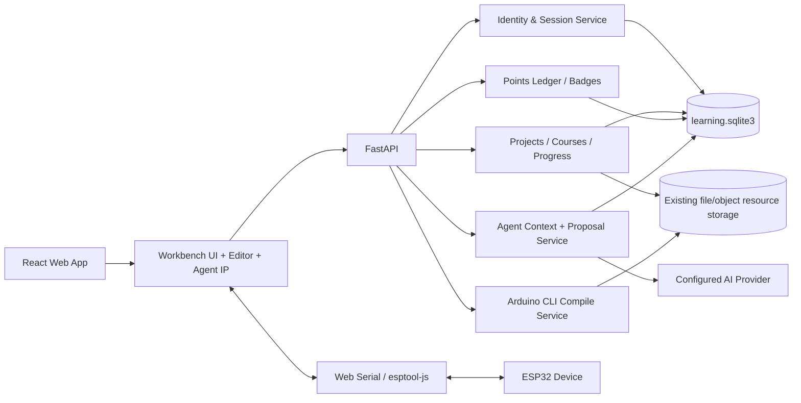

# Architecture — MakeFast Learning Platform MVP

## 1. Architecture summary

Retain the existing React SPA + FastAPI service split and hardware toolchain. Add an authenticated personal learning domain beside existing compile/template/admin domains. Keep browser-connected hardware operations in the browser; keep cloud build, durable account/project state, course publishing and reward rules on the server. The Agent is a context-aware orchestration layer over the existing AI provider, not a browser-controlling autonomous process. School education tenancy remains a post-MVP extension seam, not a current component.

## 2. Existing system boundaries

- Preserve the behavior and schemas of `/api/compile`, board APIs, firmware storage, Web Serial upload flow, existing template/course resource routes and administrator tools during staged rollout, while adding the confirmed learner-session gate to compile/editor/private resource access. Cutover must not rely only on frontend hiding.
- Existing general AI generate endpoints are not account-scoped and return generated code text. New Agent endpoints must add authenticated ownership checks and bounded context; they must not reinterpret old chat as persisted Agent session state.
- Existing admin login/configuration remains a separate auth domain. Do not reuse administrator credentials or trust admin JWTs as learner sessions.
- Existing course folders/templates are resource discovery/content inputs. Structured `CourseVersion` definitions are the learning flow source; course resources remain files/URLs referenced by stable resource IDs.
- Aily Blockly is the primary functional reference for MakeFast wiring, not an optional inspiration. Its board/component pinmaps, AWS wiring syntax, pin resolver, connection types, data-flow rules, graph conversion and validation behavior define the expected quality bar. The course version's wiring graph remains authoritative for the supported XIAO ESP32-S3 Sense kit: its manually chosen, physically verified connections drive the diagram, Chinese checklist and Agent anchors. Aily's current Angular/Electron `ConnectionGraphService` is not a drop-in module for the React web app, but its mostly pure TypeScript AWS parser/types/resolver/converter can be ported or adapted under GPL. The first course must implement functional parity for the supported path, not a placeholder graph. GPL-3.0 reuse is permitted by project direction but requires preserving notices and providing corresponding source; every board/data/media package still gets a separate license record.
- Existing local editor autosave remains available as a recovery layer after login; authenticated project API is the source for cross-session/cross-device state. Pre-MVP anonymous drafts may be explicitly imported after login.

## 3. Target components

### Frontend

- `Home/ProjectOverview`: continuation, recent projects, starter project and aggregate rewards.
- `Account`: register/login, profile and session state.
- `WorkbenchShell`: course navigation, center step renderer, device debug panel and layout state.
- `StepRenderer`: data-driven step types (intro, materials, wiring, blocks/code, compile, flash, verify, challenge, quiz, completion).
- `EditorAdapter`: wraps existing Blockly and code components; persists source type and safe conversion result.
- `DeviceDebugPanel`: board inference/selection, serial controls, compile/flash feedback and local serial buffer.
- `AgentOverlay`: static IP state, semantic anchor resolver, tip bubble and continued question UI.
- `AgentProposalReview`: code/workspace diff, assumptions, dependency and apply/cancel/undo states.
- `Profile/Rewards`: project history, learning record, points ledger and badge wall.

### Backend

- `IdentityService`: registration, login throttling, opaque session lifecycle, CSRF check, learner ownership.
- `LearningService`: project CRUD, course version lookup, progress snapshots and event recording.
- `CourseAuthoringService`: admin draft/edit/validation/publish/versioning.
- `RewardService`: idempotent ledger append and badge rule evaluation in one transaction.
- `AgentContextService`: allowlisted context assembly, mode/timing policy and current user question/proposal routing.
- `AgentConversationService`: project/course-bound conversation lifecycle, ordered message persistence, explicit attachments, archive/delete and context-window selection.
- `AgentProposalService`: schema validation, ownership check, immutable proposal preview, explicit apply transition, audit/idempotency.
- Existing `CompilationService`: remains source build implementation; result events are recorded only after result is known.

## 4. Persistence and deployment decisions

- Add a dedicated SQLite database at `${APP_DATA_PATH:-./data}/learning.sqlite3`; do not place learner data in `ops.sqlite3` or `course_qa.sqlite3`.
- Use Python stdlib `sqlite3`, matching existing lightweight persistence patterns; use transactions, foreign keys, WAL, busy timeout, parameterized statements and an explicit schema version/migration runner. Avoid adding an ORM for the first iteration unless a reviewed need emerges.
- Store users, sessions, project records, course metadata/version JSON, progress events, points ledger and badge unlocks relationally. Store large media as existing resource files/object storage; code/workspace payloads use bounded project JSON/blob fields in SQLite for MVP.
- A project references an immutable published course version. Course content schema is versioned; edits create new versions rather than mutate a published version in place.
- Keep source files/workspace and project state with optimistic `revision`/`updated_at` checks; stale writes return conflict and preserve both local/server variants.
- Back up learner database independently. Restore test must include accounts, projects, progress, points and badges.

## 5. Identity and security decisions

- Personal users use username + password registration for MVP; phone/email nullable extension fields with verified flags are reserved for later. Do not offer password recovery by unverified contact.
- MVP uses a fixed child-friendly expression baseline without requesting exact age. Initial experience markers and observed actions control ability/guidance separately.
- Reuse the existing password hashing dependency/policy initially, benchmark its configured cost in deployment, and allow a reviewed migration path before public launch.
- Learner sessions use cryptographically random opaque token in HttpOnly, SameSite=Lax cookie; Secure in production; store only token hash with expiry/revocation in SQLite. Unsafe requests require a session-scoped CSRF token in `X-CSRF-Token`.
- Every learner resource route performs server-side owner validation. Public course preview uses a separate allowlisted response that excludes source, executable steps, downloads and Agent context; compile/editor/private resources require a learner session.
- Rate-limit registration/login and AI calls. Avoid returning whether a username exists for failed login; avoid logging passwords, tokens, raw code, serial text, or full prompts.
- Existing admin JWT flows remain isolated and are not silently replaced.

## 6. Course and progress data flow

1. Client fetches published course/version JSON and starts an owned project referencing that exact version.
2. Step renderer reads type/config and maps it to a known UI component; course data cannot provide arbitrary executable JS/HTML.
3. User action produces typed progress event with source (`system` or `user_confirmation`) and idempotency key.
4. Learning service validates project owner, course version and prerequisite, updates progress, then reward service appends points/unlocks badges transactionally.
5. Agent consumes only allowed current project/course state and selected diagnostics; it does not treat navigation alone as completion.

## 7. Agent and semantic anchors

- The UI emits typed events: `step_entered`, `compile_started`, `compile_finished`, `flash_started`, `flash_finished`, `serial_opened`, `serial_line_received` (local only unless opted in), `user_confirmed_hardware`, `challenge_submitted`, `quiz_answered`.
- Reducer separates platform facts, explicit user confirmations, inferred/suggested state and Agent UI state.
- Semantic anchor IDs are stable data attributes, e.g. `data-agent-target="compile-button"`; resolution checks visibility, expansion and viewport before positioning.
- Agent display state is one of `standby`, `guide`, `explain`, `listening`, `thinking`, `success`, `warning`, `waiting`.
- In guided mode, event rules can produce one contextual prompt; autonomous mode requires direct ask except significant errors/safety issues.
- Agent output is data (message, target ID, proposal payload), never executable markup or arbitrary DOM instructions.
- Apply proposal requires revision match, schema validation, explicit user action and undo snapshot. Compile/flash remain separate buttons.
- Model context is built from the selected conversation history plus allowlisted current project/course state. Raw serial output, full source and full logs are excluded by default; if the user attaches one, show the exact bounded attachment and truncate/redact before transmission. Conversation history is not silently replaced by a browser-only session.

## 8. Code/Blockly source and conversion

- Project `editor_source` is authoritative: `blocks` means persisted Blockly workspace is source and generated code is derived; `code` means code/files are source and workspace conversion is best effort.
- Keep a parser/renderer capability manifest with supported syntax subset; parser reports `complete | partial | unsupported` plus locations.
- Never replace original code with partial reconstructed Blockly output. Conversion is preview-only until user confirms; preserve undo/version snapshot.
- Agent-generated block-compatible changes use workspace schema/tooling. Code extensions identify unrepresentable ranges and remain code-only until supported.
- GPL-3.0 Aily Blockly source may be reused when it provides concrete value; before distribution, record the upstream commit and reused paths, preserve copyright/license notices, publish corresponding source, and review board/component data and media licenses separately. Avoid importing unrelated Aily application code into the first-course slice.

## 9. API and error handling

Detailed proposed routes are in [API Contracts](api-contracts.md). New routes are namespaced; existing compile and admin APIs stay backward compatible. Errors include stable code, human-safe message and optional field details. Use `401` for missing/expired session, `403` for ownership/role violation, `404` for absent private resource without cross-user enumeration, `409` for revision/course version conflict, `422` for validation, and `429` for rate limits.

## 10. Observability

- Correlation ID per request; metrics for auth outcomes, save latency/failures, course funnel, agent latency/errors, compile/flash success, reward idempotency and data migrations.
- Store event types and bounded metadata only; never log secrets/full generated code/serial output by default.
- Agent prompt/template version and proposal outcome may be recorded for debugging without private raw context. Persisted user conversation messages are stored in the learning database; analytics uses bounded metadata rather than copying full transcripts.

## 11. Architecture decisions / gates

| Decision | MVP choice | Reason / gate |
|---|---|---|
| Learning persistence | Separate SQLite + stdlib sqlite3 | Matches single-node deployments and current lightweight persistence; design repository boundary for later PostgreSQL |
| Learner auth | Opaque cookie session + CSRF | Web app first-party same-site session, explicit revocation |
| Course structure | Versioned validated JSON per course version in relational rows | Iterates content schema while stable IDs/progress version binding remain enforceable |
| Serial privacy | Browser-session memory by default | Avoids unneeded personal hardware logs/model leakage |
| Agent shape | Context service + proposals, UI overlay | Enables state-aware guidance without autonomous browser control |
| IP art | Static first; UI-rendered states | Validate interaction before costly animation pipeline |
| User model phone/email | Nullable reserved fields | MVP username/password is confirmed; recovery verification is future work |
| Child expression | Fixed child-friendly MVP baseline, separate from ability/mode | Avoids age collection while keeping instructions suitable for primary students |

### Architecture review decisions — 2026-09-27

- **First delivery shape:** implement the first verified course as a vertical slice on top of the existing React + FastAPI application. Do not build a general course-generation skill or arbitrary hardware compatibility layer before the demo course works end to end.
- **Hardware scope:** the course pins `XIAO ESP32-S3 Sense` as its board identity, uses only externally exposed GPIO that are verified not to conflict with Sense peripherals, and does not expose camera, microphone or SD configuration in the learner flow.
- **Aily integration:** GPL-3.0 is an accepted project direction. Reuse or port the pure connection-graph core first: AWS parser, pin resolver, component/pin models, connection-type/data-flow rules, graph converter and validator. Replace only the host adapters: Aily's Electron filesystem/project service becomes a MakeFast course-pinmap repository, and the Aily iframe/Angular presentation becomes a React renderer. The first-course path must retain the mature behaviors (pin resolution, conflict errors, power/GND checks, bus semantics, direction metadata and structured output), with tests against Aily examples. Generic all-board support can follow after the verified course.
- **Course generation:** course content is authored as validated `CourseVersion` data first. A reusable course-generation skill is extracted only after the first course exposes stable fields, validation rules and publishing checks.
- **Hardware truth:** no GPIO, module variant or success observation is considered published until the fixed Sense + DHT11 + buzzer kit passes physical compile, flash, serial and audible self-test.

## 12. Testing strategy

- Backend unit/integration tests for migrations, session expiry/CSRF, resource ownership, course publish/version binding, event idempotency, reward transaction rollback and proposal apply conflicts.
- Frontend component tests for step-to-panel mapping, layout collapse, anchor fallback, source authority, preview/cancel/apply/undo, reduced motion and accessible status.
- Contract tests for new API schemas, public-preview field allowlisting, intentional authentication on `/api/compile`/AI/private resources, and compatibility tests for authenticated compile plus existing admin auth.
- E2E path: create learner → start course project → persist/restore → complete a verifiable step → compile → browser serial mocked/device smoke → progress/reward update.
- Hardware integration smoke on confirmed ESP32/sensor BOM and supported Chromium browser before course publication.

## 13. Post-MVP school education extension seam

A future education edition may add organization/class membership, teacher roles, individual student credentials, course assignment and minimal progress views. It should reuse personal learning projects, course versions, workbench, Agent and rewards. It is excluded from current migrations, APIs, Sprint dependencies and MVP acceptance; teacher course-version authoring requires a separate product and safety review.
