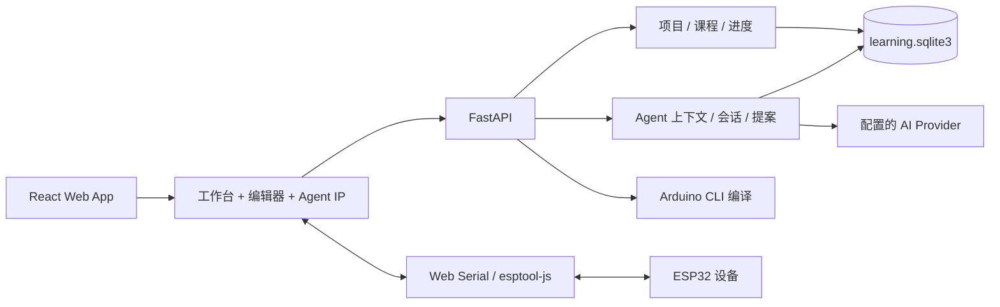

# MakeFast Agent 与平台伙伴说明

> **用途：** 给产品、内容、研发、硬件和合作伙伴快速建立共同认知。
> **资料口径：** 本文整理自 MakeFast 的 BMAD 规划产物、现有代码边界和 2026-09-28 的 Sprint 状态。文中明确区分“产品目标”“当前实现”和“发布门槛”，避免把规划能力误认为已经公开上线的能力。

## 1. 一句话理解

**MakeFast 是一个帮助初学者完成真实智能硬件作品的项目学习与创作平台；MakeFast Agent 是嵌入平台的交互式创客导师。**

用户从一个具体作品开始，按课程步骤认识材料、完成接线、编写程序、编译、烧录、观察设备反馈，再修改和挑战。Agent 负责理解当前课程、步骤、页面和可确认的设备结果，告诉用户下一步、解释原理、帮助排错，并随着用户熟练而减少打扰。

最重要的产品原则是：

> **用户亲自创造，Agent 负责看懂情境、解释操作、帮助恢复错误，并最终让用户能够独立创造。**

## 2. BMAD 规划是怎么组织的

BMAD 在本项目中是一套从产品判断到可实施任务的结构化规划基线：

| 层次 | 回答的问题 | MakeFast 主要文件 |
|---|---|---|
| 分析 | 现有系统、来源、风险是什么 | [`research-notes.md`](../_bmad-output/analysis/research-notes.md)、[`project-context.md`](../_bmad-output/project-context.md) |
| 产品规划 | 为谁解决什么问题，MVP 到哪里 | [`product-brief.md`](../_bmad-output/planning-artifacts/product-brief.md)、[`prd.md`](../_bmad-output/planning-artifacts/prd.md) |
| 体验设计 | 页面、课程步骤、Agent 如何出现 | [`ux-design-specification.md`](../_bmad-output/planning-artifacts/ux-design-specification.md)、[`experience.md`](../_bmad-output/planning-artifacts/experience.md) |
| 方案设计 | 前后端、数据、API、安全边界 | [`architecture.md`](../_bmad-output/solutioning-artifacts/architecture.md)、[`data-model.md`](../_bmad-output/solutioning-artifacts/data-model.md)、[`api-contracts.md`](../_bmad-output/solutioning-artifacts/api-contracts.md) |
| 交付管理 | 拆成什么 Story，当前做到哪一步 | [`epics-and-stories.md`](../_bmad-output/implementation-artifacts/epics-and-stories.md)、[`sprint-status.yaml`](../_bmad-output/implementation-artifacts/sprint-status.yaml) |
| 发布准备 | 什么条件满足后才能试点/公开 | [`implementation-readiness.md`](../_bmad-output/solutioning-artifacts/implementation-readiness.md)、[`current-phase-guide.md`](../_bmad-output/implementation-artifacts/current-phase-guide.md) |

本文不是替代 BMAD 原文，而是给伙伴的统一入口。

## 3. MakeFast 平台是什么

### 3.1 产品定位

现有 MakeFast 已具备在线代码/Blockly 编辑、Arduino CLI 编译、浏览器串口烧录、串口监视、课程资源和管理员维护等工具能力。产品升级的核心，是把这些工具组织成一条“从作品目标到真实设备反馈”的学习路线。

平台不以“打开一个空编辑器”为首屏，而以“继续上次项目、开始一个明确作品、查看进度和奖励”为入口。课程内容、编辑器、硬件工具、进度和 Agent 属于同一个项目工作区。

### 3.2 目标用户

| 用户 | 主要需要 | 当前范围 |
|---|---|---|
| 初次接触智能硬件的学习者 | 知道先做什么、材料怎么接、编译和烧录有什么区别 | MVP 核心用户 |
| 小学生及其协助家长 | 儿童友好的短句、安全提示、可恢复的个人账号 | MVP 使用个人版，不采集精确年龄 |
| 有经验的创客 | 直接进入项目，少提醒，自主修改和排错 | MVP 支持 autonomous 模式 |
| 课程作者/管理员 | 用结构化步骤维护材料、接线、代码、挑战、测验和版本 | MVP 支持管理端课程发布链路 |
| 学校教师 | 班级、学生账号、课程分配、班级进度 | 后续教育版，当前不做 |

### 3.3 MVP 主线

首个纵向场景是“温湿度提醒器”：

1. 预览最终作品和课程目标。
2. 注册/登录后创建个人课程项目。
3. 认识开发板、传感器和蜂鸣器。
4. 逐项确认材料。
5. 按经过验证的课程接线图接线。
6. 选择 Blockly 或代码方式完成程序。
7. 编译、烧录并查看串口。
8. 确认传感器读数和蜂鸣器效果。
9. 修改报警阈值，完成知识检查和改造挑战。
10. 获得基础完成/深度掌握对应的进度、积分和徽章。

首发推荐套件是 **Seeed Studio XIAO ESP32-S3 Sense + 三针 DHT11 温湿度模块 + 三针 3.3V 有源蜂鸣器模块 + 杜邦线 + USB 线**。课程只使用外露 GPIO，不使用 Sense 的摄像头、麦克风和 SD 功能。蜂鸣器 SKU、课程 GPIO、库版本、pinmap 和每条连接仍必须以实际采购和硬件烟测为准；未验证时不能写成确定接线指令。

## 4. Agent 到底是什么

### 4.1 它不是普通聊天机器人

普通 LLM 的基本模式是“用户提问 → AI 回答”。MakeFast Agent 的基本模式是：

```text
课程/项目状态
  → 观察当前页面、步骤和平台事件
  → 判断用户是否需要引导、解释、排错或挑战
  → 指向一个语义目标并给出短提示
  → 用户亲自操作
  → 平台返回编译、烧录、串口或确认结果
  → Agent 决定下一步
```

LLM 是语言理解和生成能力的一部分；课程状态、事件、工具、规则、权限、提案审批和持久化共同组成 Agent 系统。

### 4.2 Agent 的四个目标

| 目标 | 具体表现 |
|---|---|
| 带着完成项目 | 理解课程目标、当前步骤、完成条件和前置关系 |
| 帮用户理解原理 | 在当前需要时解释 GPIO、GND、传感器、代码逻辑、编译/烧录区别 |
| 检查是否真正掌握 | 在关键步骤后提出小问题、解释答案、提供改造挑战 |
| 逐步减少依赖 | 第一次手把手，重复练习时减少提示，鼓励用户自己修改和排错 |

### 4.3 Agent 能做什么

- 根据课程和项目状态告诉用户“下一步做什么”。
- 通过语义锚点指向一个具体按钮、步骤、编辑区或接线目标。
- 解释操作目的，例如“编译是检查程序，不会把程序写入开发板”。
- 读取真实的平台事件，例如编译成功/失败、烧录结果、串口摘要和知识检查结果。
- 给出短知识卡片、错误解释、排查顺序和常见原因。
- 生成或修改代码/Blockly 候选，展示差异、依赖、硬件假设和可逆性。
- 保存按课程项目归属的多轮会话，支持命名、切换、归档、恢复和删除。
- 根据能力和当前模式调整主动程度、句子长度和术语解释。

### 4.4 Agent 必须保留的用户动作

用户需要亲自选择开发板、准备和连接硬件、点击编译/烧录、观察设备现象、确认现实结果、回答知识问题和尝试改造。Agent 不得：

- 代替用户点击关键编译、烧录或现实硬件确认。
- 把用户勾选“我已接好”说成平台已经看见真实接线。
- 把推测当成硬件事实，尤其不能猜 GPIO、电压或模块变体。
- 未经确认覆盖代码、Blockly、项目版本或安装依赖。
- 自动编译、烧录或执行任意浏览器/DOM 指令。

## 5. Agent 的交互模式

### 5.1 三档主动程度

| 模式 | 适用场景 | 行为 |
|---|---|---|
| `guided` 新手引导 | 第一次课程、明确需要手把手 | 新步骤、首次操作、卡住、失败时主动提示 |
| `assisted` 适度协助 | 已能完成常规动作 | 关键节点、连续失败或主动召唤时提示 |
| `autonomous` 自主创作 | 熟练用户、自由项目 | 默认安静，主要响应主动提问和重要错误/安全事件 |

新手引导与自主创作是同一个工作台的不同干预程度，不是两个割裂的产品。

### 5.2 Agent 视觉状态

角色是跨区域的引导层，不是永久占据右侧的聊天栏。首版使用静态透明状态素材和轻量动效，文字、箭头和按钮由页面 HTML/CSS 渲染。

| 状态 | 意义 | 典型表现 |
|---|---|---|
| `standby` | 可召唤，没有主动任务 | 工作台边缘的小头像 |
| `guide` | 指明一个下一步目标 | 角色移动到语义锚点旁，给一句行动提示 |
| `explain` | 解释原理或原因 | 面向目标展示短知识卡片 |
| `listening` | 等待用户问题 | 输入焦点和等待提示 |
| `thinking` | 正在请求/分析 | 明确显示正在分析 |
| `success` | 平台已确认成功事件 | 说明具体完成了什么 |
| `warning` | 错误、风险或不确定项 | 解释原因候选和下一步 |
| `waiting` | 等待用户或线下确认 | 明确写出用户要执行/确认的动作 |

### 5.3 何时主动出现

可以主动出现：进入新步骤、首次使用控件、停留较久、连续编译失败、完成重要操作、出现新的设备反馈、需要确认真实硬件结果。用户正在连续编辑、已关闭当前提示或选择安静模式时应减少打扰。

一次只指引一个主目标；锚点隐藏、折叠或不在视口时，先尝试展开和滚动，失败后退化为普通可访问提示，不使用坐标猜位置。

## 6. 平台工作台与用户流程

### 6.1 三栏工作台

```text
顶部：MakeFast / 项目名 / 保存状态 / 连接设备 / 设备设置 / Agent / 个人入口
左侧：课程步骤与状态
中间：当前步骤的说明、材料、接线、Blockly/代码、编译、验证、挑战
右侧：设备调试、板卡、串口、波特率、日志、编译/烧录反馈
```

- 左侧是路线导航；每个步骤决定中间面板内容。
- 中间是学习和创作主区域；编译/烧录是动作，不与 Blockly/代码并列成独立学习模式。
- 右侧是跨步骤的设备工具，可收起、自动开合或手动固定。
- 顶部始终保留清晰的“连接设备”和连接状态。
- 旧的固定 AI 对话框不与角色 Agent 并存；串口和日志保留在设备调试区。

### 6.2 课程步骤类型

结构化 `CourseVersion` 驱动步骤渲染，而不是靠一篇长文章描述全部流程。首发步骤包括：

| 步骤 | 用户看到的内容 | 完成证据 |
|---|---|---|
| 项目介绍 | 成品、目标、时间、材料 | 开始制作，创建项目 |
| 认识最终作品 | 板卡/传感器/蜂鸣器的准确图片和解释 | 用户查看核心部件 |
| 准备材料 | 数量、用途、型号、来源、兼容性 | 用户逐项确认，状态可恢复 |
| 接线 | 结构化接线图、中文名称、英文丝印、作用 | 规则无已知冲突 + 用户确认实物连接 |
| 程序逻辑 | Blockly 与代码视图 | 保存项目源和转换状态 |
| 编译 | 编译动作、过程、错误解释 | 服务端编译结果 |
| 烧录 | 设备/串口状态、编译和烧录区别 | 用户确认并获得烧录结果 |
| 验证输出 | 串口摘要、预期现象、实物确认项 | 平台证据与用户确认分开记录 |
| 改造挑战 | 修改报警阈值或扩展功能 | 再次编译/烧录/验证 |
| 知识检查 | 小问题和答案解释 | 答题结果 |
| 完成回顾 | 成果、学习内容、奖励、下一步 | 基础完成或深度掌握 |

### 6.3 材料与接线的可信度

接线图、中文清单、逐根引导和 Agent 锚点必须从同一个结构化 wiring graph 生成。课程发布前，每个板卡/模块变体、引脚引用、图片来源和连接关系都要有核验状态。

平台可以检查重复引脚、缺少电源/GND、明显电压或方向冲突；它不能仅凭用户点击就宣称真实硬件已接对。杜邦线颜色不参与规则判断。

## 7. Agent 的工作机制

### 7.1 观察—判断—引导—检查

1. **观察：** 当前课程/版本、项目、步骤、模式、编辑源、板卡、事件、编译结果、串口摘要和用户确认。
2. **判断：** 用户是刚开始、正常推进、卡住、编译失败、设备无反馈，还是已经可以进入挑战。
3. **引导：** 选择一个语义目标，给出行动提示、知识卡片、错误解释、提案预览或确认请求。
4. **检查：** 等待用户操作和平台反馈，更新进度并决定是否继续、收敛提示或切换到排错。

导航本身不能代表完成；完成需要平台结果、用户确认或课程规则允许的证据。

### 7.2 事件驱动

前端和后端通过类型化事件让 Agent 看到有意义的变化，例如：

`step_entered`、`compile_started`、`compile_finished`、`flash_started`、`flash_finished`、`serial_opened`、`serial_line_received`、`user_confirmed_hardware`、`challenge_submitted`、`quiz_answered`。

原始串口默认只在浏览器内使用；只有用户明确选择附加时，才发送有界、可标识的摘要。Agent 输出是数据对象（消息、状态、目标 ID、提案），不是可执行 HTML 或任意 DOM 指令。

### 7.3 工具层

Agent 负责判断，工具负责读取和执行受控动作。典型工具包括课程上下文、学习状态、页面状态、板卡/pinmap、组件和库要求、接线方案生成/校验、知识卡片、代码/Blockly 候选、编译结果、错误分析、串口摘要、进度保存、用户确认、知识问题和挑战推荐。

这种分层让 Agent 行为可追踪、可测试、可审计，也让硬件和权限规则不依赖模型自觉。

## 8. 代码、Blockly 与 Agent 提案

项目始终明确哪一种编辑源是权威：

- `blocks`：Blockly 工作区是源，代码是生成结果。
- `code`：代码/文件是源，转换到 Blockly 只在受支持语法范围内尽力完成。

代码到 Blockly 不保证任意 C++ 的无损转换。遇到无法表达的代码，必须保留原代码并标记 `partial` 或 `unsupported`，不能静默丢失。

当用户明确要求“添加/修改功能”时，Agent 生成 `AgentProposal`：

1. 保存基准项目 revision。
2. 展示前后差异、影响文件/积木、依赖和硬件/引脚假设。
3. 用户可以取消、拒绝或确认应用。
4. 应用前校验 revision 和 schema；过期时拒绝覆盖。
5. 应用后保留可撤销快照。

提案应用不会自动编译、安装依赖或烧录。

## 9. 平台技术结构



| 层 | 主要技术/职责 |
|---|---|
| 前端 | React 19、TypeScript、Vite、Zustand、Blockly、Monaco/多文件编辑器、`esptool-js` |
| 后端 | Python 3.10+、FastAPI、Pydantic、Arduino CLI 服务 |
| 浏览器设备层 | Web Serial 直接连接硬件；生产环境要求 HTTPS，推荐 Chrome/Edge |
| 学习数据 | 独立 `learning.sqlite3`；用户、项目、课程版本、事件、积分、徽章、会话、提案 |
| 内容资源 | 现有文件/对象资源存储；课程发布为不可变版本 |
| AI 层 | 已配置的模型提供商，由上下文服务组装允许发送的上下文 |
| 部署 | Docker Compose；后续可在不改变领域边界的情况下迁移更强持久层 |

### 9.1 关键后端领域

- `IdentityService`：注册、登录、限流、会话、CSRF、学习者所有权。
- `LearningService`：项目 CRUD、课程版本、进度快照和学习事件。
- `CourseAuthoringService`：课程草稿、校验、发布、不可变版本。
- `RewardService`：幂等积分流水和徽章规则。
- `AgentContextService`：允许列表上下文、模式/时机策略、问题路由。
- `AgentConversationService`：按项目/课程绑定的持久会话。
- `AgentProposalService`：提案校验、预览、显式应用、审计和撤销。
- `CompilationService`：沿用现有编译实现，只有结果确定后才记录事件。

### 9.2 关键接口概念

| 领域 | 典型接口 | 规则 |
|---|---|---|
| 账号 | `/api/auth/register`、`/api/auth/session`、`/api/auth/me` | HttpOnly 会话；写请求需要 CSRF |
| 课程/项目 | `/api/learning/courses/...`、`/api/learning/projects/...` | 访客只拿公开预览；私有项目服务端校验 owner |
| 进度/奖励 | `/api/learning/projects/{id}/events`、`/api/users/me/rewards` | 事件带幂等键；客户端不能自行提交积分 |
| Agent | `/api/agent/ask`、`/api/agent/proposals`、`.../apply` | 只读授权上下文；提案必须显式应用和 revision 匹配 |
| 课程管理 | `/api/admin/learning/courses/...` | 管理员独立鉴权；发布后版本不可变 |

## 10. 数据、隐私与安全边界

平台需要清楚区分四类信息：

| 类型 | 例子 | 处理方式 |
|---|---|---|
| 平台事实 | 编译成功、当前课程版本、已收到串口摘要 | 可作为 Agent 上下文，但按允许列表提供 |
| 用户确认 | “我已按图接好”“我看到蜂鸣器响了” | 单独记录，不伪装成系统检测 |
| Agent 推断 | “可能是库版本不兼容” | 明确标注为候选原因，不能当结论 |
| 未验证信息 | 未实测 GPIO、未知模块变体、未授权图片 | 不写成课程指令，不发布为正式内容 |

主要边界：

- 访客只能看课程预览和步骤目录；源代码、Blockly、固件、受保护附件、工作台、编译和 Agent 需要登录。
- 学习者使用独立账号；管理员认证域不与学习者会话混用。
- 会话 cookie 使用 HttpOnly/SameSite，生产环境 Secure；写请求使用 CSRF。
- 项目和课程版本服务端校验归属；revision 冲突不能覆盖较新内容。
- 已发送的 Agent 会话属于用户学习记录，可恢复、归档和删除；未发送草稿不作为服务端记录。
- 原始串口、完整源码、完整日志默认不进入模型；用户明确附加时才做有界传输，并显示附加内容范围。
- 不默认收集精确年龄、真实姓名、电话、住址、学校全名或家庭信息；面向小学生公开前仍需完成儿童隐私和告知/同意审查。
- 任何直接复用 Aily Blockly 的 GPL-3.0 代码，都必须保留版权/许可证、记录上游版本、提供对应源代码；板卡数据和媒体另行核查许可。

## 11. 进度、积分与奖励

课程完成分成两层：

- **基础作品验证：** 完成关键接线/编译/烧录/设备反馈闭环，尽快获得“做出来了”的成就。
- **深度掌握：** 通过知识检查和改造挑战，证明理解并能修改作品。

奖励由服务端根据事件和规则发放，不接受客户端直接报分。相同能力的合格练习按新颖度递减：第一次 `100%`、第二次 `50%`、第三次 `25%`，之后的机械重复不再自动发分；具体规则用版本号保存，不悄悄重算历史流水。

## 12. 当前实现状态（2026-09-28）

### 12.1 已完成或已有验证证据

- 学习者注册、登录、退出、会话和 CSRF 边界。
- 个人项目创建、保存、归档、版本冲突保护和首页学习总览。
- 结构化课程 schema、管理端草稿/校验/发布接口、不可变课程版本。
- 数据驱动三栏工作台：课程步骤、中心内容、右侧设备调试区。
- 材料逐项确认、刷新恢复、项目自动保存、步骤切换和窄屏基本适配。
- 编译/烧录/串口调试区的界面边界和无设备时按钮禁用状态。
- Agent 上下文问答、项目/课程绑定会话和继续提问的接口方向。
- Agent 提案的预览、显式应用、revision 冲突保护、拒绝和撤销。
- 积分流水、重复事件幂等、徽章条件和个人奖励展示。
- 软件回归矩阵、发布/备份/功能开关/回滚手册。

当前验证记录包含：前端全量 `23 个测试文件 / 135 项`、生产构建、后端学习闭环和 Agent 无障碍语义回归通过；这不等于真实硬件验收，也不等于首门课程已经公开发布。

### 12.2 仍未关闭的发布门槛

| 状态 | Story/门槛 | 还缺什么 |
|---|---|---|
| `blocked` | `ST-303` 首门课程硬件核验 | 固定实际 SKU、准确图片/许可、pinmap、逐线实测、编译/烧录/串口/蜂鸣器烟测 |
| `blocked` | `ST-403` 结构化接线图 | 真实板卡/模块图片、物理引脚坐标、与课程 wiring graph 一致并通过实测 |
| `review` | `ST-402` 设备调试 | 软件 UI 已接入，仍需真实硬件路径验收 |
| `review` | `ST-501`/`ST-502` 编辑器和 Agent IP | 需要最终静态角色素材、完整语义锚点和发布前视觉/无障碍验收 |
| `review` | `ST-701` 试点质量 | 需要 ST-303/ST-403 的硬件证据后才能关闭 |
| 发布门槛 | 儿童隐私、AI 数据、账号恢复/删除 | 明确告知/同意、上下文和留存策略、导出删除与运营流程 |

因此当前更准确的表述是：**MakeFast 的个人学习平台和 Agent MVP 已完成大量软件骨架与验证，但首门课程仍处于硬件/素材/隐私门槛阶段，尚不应宣称为完整公开课程。**

## 13. 后续路线

1. 固定首发套件型号、图片来源和准确引脚，完成真实硬件烟测。
2. 用经过验证的 wiring graph 替换占位接线图，并让图、清单和 Agent 锚点共用数据源。
3. 完成 Agent 角色静态素材、编辑器转换能力和视觉/无障碍验收。
4. 完成儿童隐私、AI 上下文、会话留存、账号删除/导出和备份恢复政策。
5. 进行小规模试点，重点观察 Agent 指向正确率、提示后目标操作完成率、硬件闭环完成率和三阶段自主度变化。
6. 未来再扩展学校教育版：组织/班级、教师角色、学生凭据、课程分配和班级进度；复用个人版项目、课程、工作台、Agent 和奖励，不另起一套学习产品。

## 14. 伙伴协作时的统一说法

对外介绍时可以这样说：

> MakeFast 是一个以真实硬件作品为中心的学习与创作平台。用户不需要先面对空白编辑器，而是从一个明确作品开始，按课程路线完成材料准备、接线、编程、编译、烧录和设备验证。MakeFast Agent 是工作台里的交互式创客导师：它能理解当前项目和课程状态，在需要时指向具体控件、解释原理、帮助排错、提出小挑战，并把用户从手把手引导带到能够独立修改作品。

不要把它说成“AI 自动帮用户做完硬件项目”“通用聊天机器人”“可以看见用户手里接线的视觉识别系统”，也不要把未完成硬件核验的课程说成已经正式上线。

## 15. 进一步阅读

- [MakeFast Agent 设计说明](competition/MAKEFAST_CONTEST_BRIEF.md)：Agent 的产品定义、交互循环、工具层和边界。
- [MakeFast BMAD 产物导航](../_bmad-output/README.md)：全部规划文档入口和状态约定。
- [产品简报](../_bmad-output/planning-artifacts/product-brief.md)：用户、价值主张、MVP 成功条件和范围。
- [PRD](../_bmad-output/planning-artifacts/prd.md)：需求、指标、验收和产品风险。
- [UX 设计规格](../_bmad-output/planning-artifacts/ux-design-specification.md)：页面结构、三栏工作台、课程步骤和 Agent IP。
- [架构](../_bmad-output/solutioning-artifacts/architecture.md)：前后端边界、Agent 服务、数据流和安全决策。
- [数据模型](../_bmad-output/solutioning-artifacts/data-model.md)：用户、项目、课程、事件、奖励、会话和提案。
- [API 合同](../_bmad-output/solutioning-artifacts/api-contracts.md)：学习者、项目、课程、Agent 和管理员接口。
- [当前阶段指南](../_bmad-output/implementation-artifacts/current-phase-guide.md)：每个 Story 的目标、完成标准、验证结果和下一步。
- [Sprint 状态](../_bmad-output/implementation-artifacts/sprint-status.yaml)：当前 Story 状态的机器可读基线。
- [回归矩阵](verification/mvp-regression-matrix.md) 与 [试点回滚手册](operations/pilot-release-rollback-runbook.md)：试点验证、功能开关、备份和回滚。
